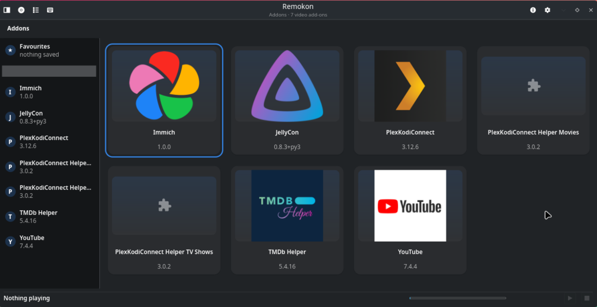
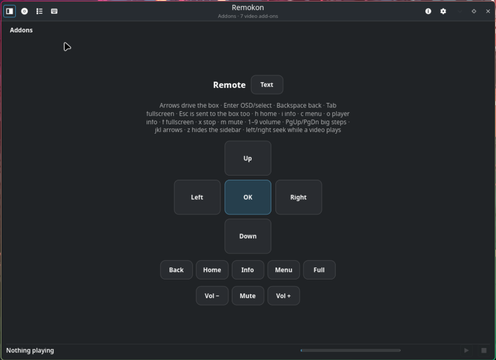

<div align="center">

# Remokon — Kodi Remote

**Kodi, from the keyboard.**

A fast GTK4 desktop remote for Kodi — browse your add-ons, drive playback, and never
pick up the TV remote again.

[](LICENSE)
[](https://www.python.org)
[](https://gtk.org)
[](https://kodi.tv)
[](#requirements)

</div>

---

## Why

Kodi is a media centre you sit in front of, but its web UI is a phone remote stretched to
a desktop, and its add-ons are a directory tree with no keyboard in sight. Remokon is
what you get when a Kodi box is driven from a real keyboard on a real screen: the add-ons
are a poster grid you arrow through, the remote is one keystroke away, and the same
window keeps your place.

Named after リモコン (*rimokon*), the Japanese word for a remote control.

## Screenshots

| Browsing | The remote |
|:---:|:---:|
| [](docs/screenshot-addons.png) | [](docs/screenshot-remote.png) |
| Sidebar of installed add-ons, favourites on top, poster grid with a live selection. | D-pad, transport, volume — one line reminding you what every key does. |

The grid has five faces — posters, compact, wide thumbs, full-width billboards and a dense
list — cycled with `v`, and the artwork fills the card in all of them.

## Features

- **Browse every video add-on** on the box as a folder tree — artwork, breadcrumbs,
  filtering, and five view modes (posters, compact, wide thumbs, billboards, list). The
  artwork fills its card in every one of them.
- **Favourites** for the places you keep going back to, right in the sidebar.
- **A real remote** — d-pad, back/home/info/menu, fullscreen, volume, mute, steps.
- **A player you can drive.** A Now playing page with the artwork, the plot, a bar you can
  drag, ±10 s and ±60 s, previous/next in the queue, volume and mute — and every key the
  remote has works there too.
- **A queue.** Send anything to *play next* from the item menu, then work the list in a
  panel on the right: play an item now, move it, drop it, clear it. What has played leaves
  the queue on its own, so the list is always what is still to come.
- **Three surfaces, one window.** `\` walks browsing → remote → the player → back, and the
  browser returns exactly where you left it: same folder, same selection, same scroll.
- **Type with your keyboard.** When Kodi opens its on-screen keyboard, Remokon pops a
  text box that types into it — and `t` opens one by hand.
- **Space pauses, `,`/`.` seek, from anywhere** — no need to leave the grid.
- **`?` explains itself.** Every binding, grouped, in the app.
- **Nothing baked in.** Point it at any Kodi box from the settings page; the config is
  yours, one small file.

## Requirements

- Linux with **GTK 4** and **libadwaita** (`gtk4`, `libadwaita`, `python-gobject` on
  Arch; `gir1.2-adw-1` and `python3-gi` on Debian/Ubuntu).
- **Python 3.11+**, the system interpreter — a conda/miniforge `python3` has no `gi`.
- **Kodi 19 or newer** with *Settings → Services → Control → Allow remote control from
  other systems* enabled, plus a username/password if you set one.

## Install

```sh
git clone https://github.com/bpawnzZ/remokon.git
cd remokon
./install.sh
```

That builds a single-file app, installs it to `~/.local/bin/remokon`, and adds a menu
entry and icon. Prefer to run it from the checkout? `./run.sh`.

No pip packages, no virtualenv, no bundled toolkit: the app is two stdlib-only Python
modules on top of the GTK already on your system.

## First run

Remokon starts on its **settings page** — there is no default host. Fill in:

| Field | Notes |
|---|---|
| **Address** | hostname or IP of the Kodi box, e.g. `kodi.lan` |
| **Port** | `8080` unless you changed Kodi's web server port |
| **Scheme** | `https` only if the box sits behind a TLS proxy |
| **Username / Password** | the Kodi web server credentials, if any |

Press **Save and connect**. The settings page then lives behind the gear button (top
right) and reopens prefilled; `Esc` closes it.

Settings are stored in `$XDG_CONFIG_HOME/remokon/config.json`
(`~/.config/remokon/config.json`), readable only by you. Favourites and the current view
live in the same file, so one copy is the whole state.

## Keys

`?` in the app is the authoritative list. The short version:

**Browsing**

| Key | |
|---|---|
| `↑ ↓ ← →` · `Enter` · `Backspace` | move the selection · open or play · up a level |
| `j k l` | down / up / right |
| `/` | filter this list (`Esc` clears) |
| `v` · `Ctrl +` `Ctrl -` | change view · bigger / smaller tiles |
| `s` · `,` `.` | stop · seek back / forward while a video plays |
| `c` | menu for the selection: play, add to queue, ★ Favourites (also right-click) |
| `q` | the queue panel: what the box plays next |
| `Tab` | jump between the sidebar and the grid |

**Remote**

| Key | |
|---|---|
| `↑ ↓ ← →` · `Enter` · `Backspace` | d-pad · select (OSD when fullscreen) · back |
| `Esc` | back, sent to the box |
| `h` `i` `c` `o` `f` `m` | home · info · context menu · player info · fullscreen · mute |
| `1`–`9` · `0` · `=` `-` | set the volume · mute · volume up / down |
| `PgUp` `PgDn` | big step back / forward |
| `t` | type into the box's keyboard dialog |

**Now playing**

| Key | |
|---|---|
| `←` `→` | seek 10 seconds back / forward |
| `PgUp` `PgDn` | a minute back / forward (the −60 s and +60 s buttons) |
| `Space` · `Esc` | play / pause · back to browsing |
| `i` `o` `c` `f` `m` `x` `h` | the same box keys as on the remote |

Drag the bar to seek anywhere; the drag commits one seek when you let go.

**Everywhere**

| Key | |
|---|---|
| `\` | browse → remote → now playing → browse |
| `q` | show / hide the queue panel |
| `Ctrl+B` | hide / show the sidebar |
| `Space` | play / pause |
| `x` | stop |
| `r` · `n` | remote · now playing |
| `?` | this list, in the app |

## How it talks to Kodi

Plain [JSON-RPC over HTTP](https://kodi.wiki/view/JSON-RPC_API) — `Files.GetDirectory`
for the tree, `Player.*` for playback, `Playlist.*` for the queue, `Input.*` for the
remote. No add-on, no plugin, nothing installed on the box, and the password never leaves
your machine. The queue is Kodi's own video playlist, so it survives closing the app.

## Development

```sh
./run.sh                                       # run from the tree
./build.sh                                     # single-file build in dist/

/usr/bin/python3 tests/test_kodi.py            # protocol + config, no display needed
EGL_PLATFORM=x11 xvfb-run -a /usr/bin/python3 tests/test_ui.py   # the window
```

The window tests drive a real GTK window against a fake Kodi, so they need X or Xvfb;
on NVIDIA under Wayland prefix them with `EGL_PLATFORM=x11` (GDK's EGL probe loads
`libnvidia-egl-wayland` inside X and segfaults).

Found a bug? Open an issue with what you expected and what happened.

## License

MIT © bpawnzZ. See [LICENSE](LICENSE).
